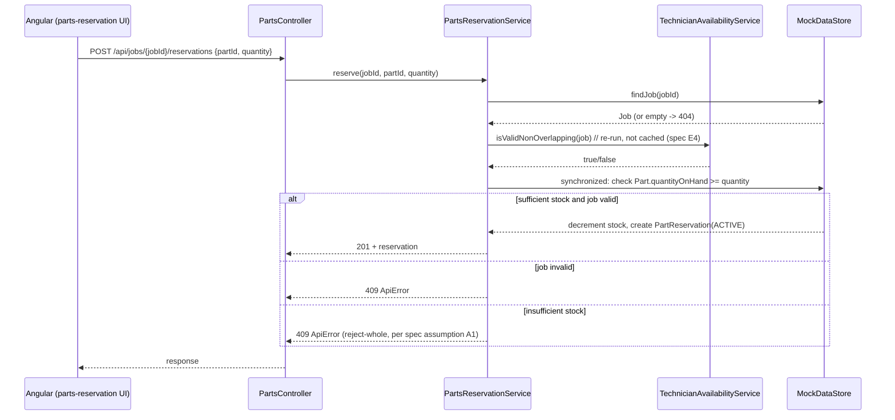

> **📛 IMPORTANT ARTIFACT:** Non-code file — see `AGENTS.md` for why the pipeline separates specs, decisions, ADRs, and code.

# ADR — Feature 2: Parts Reservation

| Field | Value |
|---|---|
| **Status** | Proposed — pending human sign-off before `developer-agent` starts |
| **Feature spec** | `pipeline/features/feature-2-parts-reservation.md` |
| **Author** | `architect-agent` (see `.claude/agents/architect-agent.md`) |
| **Depends on** | Feature 1's interval-overlap check and `TRAVEL_BUFFER_MINUTES` (both named as dependencies D1/D2 in the Feature 2 spec) |

## 1. Architecture Design

### Data model (additive to `MockDataStore`, per `migration-safety-skill`)

Two new models, package `com.serviceforge.model`, package-by-layer as `build-code-skill` requires:

```
Part            { id, name, quantityOnHand }
PartReservation { id, jobId, partId, quantity, status }   // status: ACTIVE | RELEASED
```

No existing model (`Technician`, `Job`, `JobStatus`) changes shape. `PartReservation` references `jobId`/`partId` by id only, the same way `Job` already references `technicianId` — consistent with the existing store's pattern of flat lists + id lookups, not nested object graphs.

### Data flow



Job cancellation flow (spec AC-8/E2): `JobController`'s existing cancel path calls `PartsReservationService.releaseAllForJob(jobId)` synchronously in the same request — there is no async/event bus in this repo, so "automatically releases" means a direct method call in the same transaction-equivalent (single-threaded mock-store update), not a queued side effect.

### Dependencies

- **On Feature 1:** `TechnicianAvailabilityService`'s current overlap-check logic, called live (not cached) on every reservation read/write — per spec D1/E4. `PartsReservationService` takes `TechnicianAvailabilityService` as a constructor-injected collaborator; it does not duplicate the interval-overlap formula.
- **On `MockDataStore`:** extended additively with `parts` and `partReservations` lists plus an id sequence for each, following the exact pattern already used for `jobs`/`jobIdSequence`.
- **New Spring beans:** `PartsReservationService` (business logic), `PartsController` (REST surface) — both follow `build-code-skill` conventions (constructor injection, `ResponseEntity<T>`, `ApiError` for 404/409).
- **Frontend:** `part.model.ts`, `part-reservation.model.ts`, `parts-reservation.service.ts` (HTTP calls isolated per convention), and a UI surface on the existing job view — no new frontend module structure needed.

### Scalability

This is a single-JVM, in-memory system by design (see `AGENTS.md` — "no real database... training boilerplate"). The reservation check-and-decrement is the one place a real concurrency bug could hide (spec E1: two simultaneous reservations for the same part must not both succeed if combined quantity exceeds stock). Given the scale of this repo (a handful of seeded technicians/jobs/parts, single dev server), the correct-and-simple approach is a `synchronized` critical section in `PartsReservationService` around the check-then-decrement on `Part.quantityOnHand`, mirroring how `MockDataStore.jobIdSequence` already uses `AtomicLong` for the same class of problem (safe concurrent mutation of shared in-memory state). No queueing, no distributed lock, no new infrastructure — those would be solving a scale problem this repo doesn't have.

### Technology-selection rationale

No new dependency is introduced. Everything is built from what's already in `pom.xml` (Spring Boot Web) and the existing Angular app. This is a direct consequence of `build-code-skill`'s "do not introduce a new external dependency... without a recorded decision" — there is no case here that justifies one, so none is proposed.

## 2. Design Review — challenge before code is written

### Weakness / assumption 1 — `synchronized` is enough for correctness, but not for throughput

**Assumption:** A single `synchronized` block around the check-and-decrement is sufficient because this is a demo-scale, single-JVM app.
**Why it's a real weakness, not just theoretical:** every reservation request for *every* part serializes through one lock (if implemented at the service level rather than per-part), so a burst of unrelated reservations (different parts) still queues up behind each other.
**Alternative considered — per-part lock striping** (e.g., a `ConcurrentHashMap<Long, Object>` of per-part locks): rejected for this feature. It's the textbook "right" answer but adds real complexity (lock lifecycle, no eviction, risk of leaking locks for deleted parts) for a workload of a handful of seeded parts in a training repo. **Decision:** single coarse-grained `synchronized` method scoped to reservation mutations only (not reads), revisited only if a later feature's spec explicitly requires concurrent-load behavior at a scale where this matters.

### Weakness / assumption 2 — re-running Feature 1's overlap check on every read couples the two features tightly

**Assumption:** Spec requirement D1/E4 says reservation validity must re-check Feature 1's *live* overlap logic, not a cached result. Architecturally this means `PartsReservationService` has a hard runtime dependency on `TechnicianAvailabilityService`'s current interpretation of "valid job."
**Why it's a real weakness:** if Feature 1 ever changes what "valid" means (per the spec's own D1 warning), Feature 2 silently inherits that behavior change with no seam to intercept it — there's no adapter/interface boundary, just a direct method call.
**Alternative considered — introduce a `JobValidityChecker` interface** that `TechnicianAvailabilityService` implements, so `PartsReservationService` depends on the interface, not the concrete class: **rejected for now** — it's speculative generality for a two-class relationship inside one package; YAGNI until a second consumer of "is this job valid" actually exists. **Decision:** keep the direct constructor-injected dependency, but the spec's own D1 note (must review reservation-validation if Feature 1's check changes) is accepted as the real mitigation — a process control, not a code abstraction, matching this repo's preference for minimal indirection.

### Riskiest decision

**The `synchronized` critical section (Weakness 1) is the riskiest decision in this ADR.** It is correct for today's scale and explicitly a *reversible*, well-scoped tradeoff — but it is the one place where "worked in the demo" and "actually free of race conditions" could diverge if this repo's scope ever grows past a single JVM. It is flagged here specifically so the tester agent writes a concurrency test (spec SM-5) that would catch a regression, and so no future feature assumes this scales beyond one process without revisiting this ADR.

## 3. Key Tradeoff (recorded as this ADR's decision)

**Tradeoff:** Correctness/simplicity via a single coarse-grained lock vs. throughput via per-part lock striping or an external store.
**Chosen:** Coarse-grained `synchronized` in `PartsReservationService`, no new infrastructure.
**Reason:** Matches the repo's explicit constraint (no database, no external services, mock/in-memory only — `AGENTS.md`) and the actual scale of this training boilerplate. Revisit only via a recorded decision in `pipeline/decisions/`, per `migration-safety-skill`'s escalation path for anything beyond additive, in-memory-safe changes.

## References

- `pipeline/features/feature-2-parts-reservation.md` (spec, acceptance criteria, edge cases E1–E4, dependencies D1–D3)
- `pipeline/decisions/feature-1-decisions.md` (interval-overlap fix, travel buffer constant)
- `rules/no-overlap-booking.md`
- `.claude/skills/build-code-skill/SKILL.md`, `.claude/skills/migration-safety-skill/SKILL.md`
