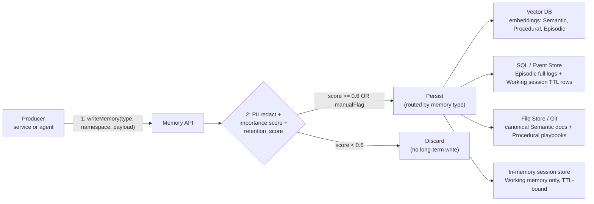
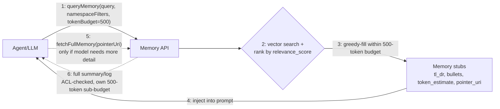

# Memory Architecture Specification — Feature 2 (Parts Reservation)

Status: Proposed
Date: 2026-09-24
Authors: GitHub Copilot (architect)

Overview
--------
This document defines a memory architecture and operational rules for Feature 2 — Parts Reservation. It is a design-first blueprint describing: the four memory boxes (Semantic, Procedural, Episodic, Short-Term/Working), storage backend choices and fallbacks, read/write policies, retention (retain/discard) rules, summarization and consolidation pipelines, token budgeting and injection rules (hard ceiling = 500 tokens), namespace scoping, JIT/progressive disclosure patterns, security requirements, and a concrete B2 implementation roadmap.

Goals
- Keep LLM prompt injections concise and high-signal.
- Preserve forensic and recurring-value artifacts in long-term stores while discarding noise.
- Enable fast, safe retrieval for agents and engineers solving reservation conflicts.
- Provide an implementation path from in-repo mock stores to production-grade Vector/SQL/Graph stores.

Decisions summary
-----------------
- Use a hybrid-store approach: Vector DB for semantic/episodic search, SQL for transactional reservation state and audit/event logs, Graph for relationship queries where needed, Git/files for canonical docs, and in-memory/Redis for short-term session state.
- Hard token ceiling for memory injection: 500 tokens total per prompt injection.
- Progressive disclosure with memory stubs and JIT fetch of full artifacts.
- Score-based Retain/Discard rules with deterministic overrides for security or outages.

Memory taxonomy: the four boxes
--------------------------------
1) Semantic memory — stable domain knowledge
   - What lives here: spec docs, API contract shapes (Part, Reservation), business rules (no-overlap-booking.md), canonical examples, AGENTS.md, and `.github/copilot-instructions.md` (repo-wide conventions every agent must load).
   - Store: canonical files in Git; short snapshots and embeddings indexed in Vector DB.
   - Retention: indefinite; versioned by commit SHA; re-embed on doc changes.
   - Read policy: inject only compressed stubs (<=100 tokens) by default.

2) Procedural memory — how-to and agent playbooks
   - What: agent skills, MCP playbooks, operational runbooks for inventory rebalancing, manual processes.
   - Store: files + small procedural table (SQL/NoSQL) for programmatic orchestration; embeddings in Vector DB.
   - Retention: medium-term; re-evaluate on code changes.
   - Read policy: summary injection; full procedure JIT.

3) Episodic memory — past runs, incidents, RCAs, bug fixes
   - What: reservation conflicts, incident notes, RCA documents, resolved bug descriptions, test failures relevant to reservations.
   - Store: summaries + embeddings in Vector DB; full logs/events in append-only SQL event-store or blob storage.
   - Retention: policy-driven; default 1 year for non-critical; critical incidents (SLA breach, outage) retained indefinitely (manualFlag).
   - Read policy: similarity + recency ranking; summaries compressed <=300 tokens before injection.

4) Short-Term / Working memory — session-scoped ephemeral state
   - What: current booking dialog state, tentative holds, uncommitted reservations, last 3–6 chat messages, immediate stack traces.
   - Store: the LLM **context window** is the live working-memory surface (the actual prompt tokens the agent reasons over); an in-memory session store (Redis or process memory) is its optional persistence/checkpoint backing so state survives a context reset.
   - Retention: TTL = session lifetime or 24h. Promote summary if retention threshold met.
   - Read/write policy: always accessible to the active session; never cross-inject across sessions without explicit link and consent.

Namespace scoping convention
---------------------------
Minimal form (as requested): `repo:branch:env`, e.g. `serviceforge:main:dev`.

Extended form used in this spec (adds feature + scope granularity needed for Feature 2): `<product>:<feature>:<branch_or_release>:<env>:<scope>`

Examples:
- serviceforge:feature-2:main:dev:session-1234
- serviceforge:feature-2:release-1.2:prod:incidents
- serviceforge:global:main:dev:specs

Rationale: prevents cross-environment contamination and eases ACL enforcement and retrieval filtering. The extended form is a strict superset of the minimal `repo:branch:env` triple — `repo` maps to `product`, and `feature`/`scope` narrow retrieval within that repo:branch:env boundary.

Storage backend selection (primary + fallback)
--------------------------------------------
- Vector DB (primary): FAISS/Chroma/Weaviate/Pinecone for embeddings (episodic + semantic). Fallback: local serialized FAISS/Chroma files persisted under /data/ or /target/.
- SQL (primary): Postgres/SQLite for parts table, reservations table, inventory snapshots, and audit/event logs. In-repo mock: MockDataStore simulates SQL behavior; B2 must keep schema compatibility.
- Graph DB (optional): Neo4j/JanusGraph for complex relationship queries. Fallback: adjacency tables in SQL.
- File store / Git: canonical documents, specs, playbooks.
- In-memory session store: Redis or process memory for working memory.

Read / Write path policies
--------------------------
All reads/writes go through a Memory API (contract) that enforces filters, redaction, indexing, and token-budget estimation.

Write pipeline (producer → memory API)
1. Producer calls writeMemory(payload, type, namespace, importance, manualFlag=false).
2. Memory API: pre-filters (size, PII redaction), importance scoring, embedding creation (for semantic/episodic/procedural), and persistence to selected backend(s).
3. If payload is transactional (reservation commit) then:
   - Persist to SQL (ACID), append structured event to event store, and create a compressed episodic summary + embedding.
4. Run retention evaluation; mark for persistence or discard.

Read pipeline (consumer → memory API)
1. Consumer calls queryMemory(queryTextOrEmbedding, namespaceFilters, typeFilters, recencyWeight, tokenBudget=500).
2. Memory API: vector search + metadata filtering → rank candidates by relevance_score.
3. Return memory stubs (id, type, tl_dr, bullets, relevance_score, token_estimate, pointer_uri). Total token_estimate of stubs ≤ tokenBudget.
4. Consumer may call fetchFullMemory(pointerUri, authContext) to JIT fetch full details (subject to ACLs).

Security, privacy, and compliance
---------------------------------
- PII Redaction: mandatory pre-store redaction. If PII is present, store a redacted summary and encrypt full artifact in a secure vault.
- ACLs by namespace and role; production logs require elevated access.
- Audit trail for all read/write operations with who/what/why/when.
- Encryption at rest for Vector DB indices and SQL blobs.

Retain / Discard policy (concrete rules)
---------------------------------------
Principle: store only recurring or forensic-value artifacts.

Score-based retention (numeric example):
  retention_score = 0.35 * recency_norm + 0.35 * importance + 0.2 * freq_norm + 0.1 * manual_flag

Where:
- recency_norm = exp(-age_days / 30) mapped into [0,1]
- importance ∈ [0,1] (producer-declared or auto-extracted)
- freq_norm = min(1, occurrences / 5)
- manual_flag = 1 if manually flagged for retention

Default threshold: retain if retention_score ≥ 0.6 (persist to episodic long-term). Otherwise discard after consolidation window.

Deterministic rules:
- Always retain: incidents causing SLA breaches, security incidents, RCAs, bug-fix PRs labeled as region-wide outages.
- Never retain: raw verbose LLM chat transcripts, raw stdout debug dumps unless summarized and flagged.
- Ephemeral promotion: when a session ends, generate a session summary; persist only if retention_score ≥ threshold.

Manual overrides:
- Engineers can mark manualFlag=true to force retention.

Summarization & hierarchical consolidation
-----------------------------------------
Purpose: compress noisy logs/events into compact, high-signal summaries suitable for embeddings and safe prompt injection.

Pipeline:
1. Normalizer: entity extraction (jobId, partId, techId, quantities, timestamps, exception), PII redaction.
2. Structured summary: JSON {title, tl_dr, bullets, tags, entities, severity, timestamp, pointer_to_full_log}.
3. Abstractive summarization (LLM) to produce a 1-line TL;DR + up to 3 bullets (max 150–300 tokens).
4. Create embedding for the summary and store summary + embedding in Vector DB; full logs persisted to event store or blob.
5. Periodic consolidation (daily/weekly): merge similar summaries into a consolidated node (hierarchical consolidation), re-embed, archive raw items to cold storage if needed.

Summarization heuristics for injection:
- TL;DR (single sentence) + 1–2 bullets; default injection length ≤ 300 tokens for episodic items.

Token budgeting & injection algorithm (HARD CEILING = 500 tokens)
----------------------------------------------------------------
Hard rule: the total tokens of injected memory content into any LLM prompt must not exceed 500 tokens.

Token estimator: use a fixed, versioned tokenizer for all estimates — `tiktoken` `cl100k_base` as the default estimator (close enough across OpenAI-family and comparable models for budgeting purposes). The Memory API computes `token_estimate` at write time (cached on the stub) so query-time budgeting is O(1) summation, not re-tokenization.

Default allocation (example):
- Working memory (session): up to 250 tokens
- Episodic memory (past incidents): up to 150 tokens
- Semantic/procedural stubs (rules, API shapes): up to 80 tokens
- Reserve (safety margin): 20 tokens

Injection algorithm:
1. queryMemory(..., tokenBudget=500) produces candidate stubs with token_estimates.
2. Greedy fill respecting priorities: working → episodic (by score) → semantic/procedural.
3. If the model asks for more detail, allow a JIT fetch of a single pointer; that fetch must also adhere to a 500-token sub-budget.

Why 500 tokens: balances helpful context with prompt window hygiene; forces compression and prioritization, reduces context rot and cost.

Progressive disclosure & JIT loading
-----------------------------------
- Return memory stubs: {id, type, tl_dr, bullets, relevance_score, token_estimate, pointer_uri}.
- Two-phase interaction:
  1) Inject stubs only (≤500 tokens) and let the model attempt the task.
  2) If the model requests more detail, fetchFullMemory(pointerUri) to retrieve an extended summary or raw log (subject to ACLs). Second retrieval must obey token budgets.

Operational rules, quotas and housekeeping
----------------------------------------
- Per-namespace quotas (default): limit episodic items to 10k per feature namespace; evict lowest-score items when exceeded.
- Archival policy: events >90 days — consolidate and archive raw logs to cold storage; keep consolidated summary in Vector DB.
- Re-embedding: re-embed semantic docs on change; re-embed consolidated nodes weekly.
- Monitoring: track read/write rates, injection token usage, retrieval precision; alert when average injection approaches 500 tokens frequently.

Example flows
-------------
1) Booking (happy path)
   - User requests hold for job J123.
   - Working memory: current draft reservation injected (≤250 tokens).
   - Commit: SQL transaction records reservation; event appended; episodic compressed summary created and embedded.
   - If conflict: vector search returns top-2 relevant incident summaries (≤150 tokens) + rule stub (≤80 tokens) → total ≤500.

2) Debug repeated conflict
   - Engineer flags incident; manualFlag=true persists it indefinitely. Future similar conflicts surface this incident via high similarity.

API sketches (Memory API)
-------------------------
- writeMemory(type, namespace, payload, importance=0.5, manualFlag=false)
- queryMemory(queryTextOrEmbedding, namespaceFilters, typeFilters, recencyWeight=0.5, tokenBudget=500) -> [memoryStub]
- fetchFullMemory(pointerUri, authContext) -> fullSummaryOrLog
- consolidateMemories(jobSpec) -> consolidationReport

PII handling & encryption
-------------------------
- Mandatory PII detection and redaction before embedding or storing.
- If PII present, create redacted summary and store full artifact encrypted with restricted ACL.
- Access to full artifacts is audited.

Migration path from mock repo to production
------------------------------------------
- In-repo mock: implement Memory API with MockDataStore for SQL-like behavior, and local serialized FAISS/Chroma for embedding index stored under /data/ or /target/.
- Production: replace adapters with managed Vector DB / Postgres / Redis / Graph clients; keep Memory API contract stable to avoid downstream churn.

Implementation roadmap for B2 (concrete tasks)
----------------------------------------------
1. Create Memory API interfaces (Java for backend service + TypeScript client adapter if needed on frontend).
2. Implement in-memory session store + session-summary writer.
3. Integrate local embedding engine (or OpenAI embeddings) and local FAISS/Chroma fallback.
4. Implement writeMemory, queryMemory, fetchFullMemory with token-estimate math and stub responses.
5. Add summarization pipeline (LLM wrapper for TL;DR + bullets) and embedding creation.
6. Implement retention scoring and nightly consolidation job.
7. Add PII redaction, ACL checks, and audit logging.
8. Add tests: retention scoring, token-budget enforcement, queryMemory integration tests using MockDataStore and local vector store.

Trade-offs & rationale
---------------------
- Vector DB for episodic recall provides fast fuzzy matching but adds cost — summarize aggressively to reduce size.
- SQL is required for transactional guarantees for reservations — do not attempt to treat event logs as canonical without ACID semantics.
- Hard token ceiling forces discipline; it trades some completeness for reliability and cost control.

Appendix — retention scoring example
-----------------------------------
Use exponential decay for recency_norm: recency_norm = exp(-age_days/30).
Then compute retention_score = 0.35*recency_norm + 0.35*importance + 0.2*freq_norm + 0.1*manual_flag.
Keep if retention_score >= 0.6.

Architecture diagram (write path)
---------------------------------

Architecture diagram (read path)
---------------------------------

Diagram legend
- Numbered edges show the strict order of operations for each path — write path always scores before persisting; read path always returns compressed stubs before any full-detail JIT fetch.
- `D1`–`D4` map 1:1 to the four memory boxes' storage choices defined above: Semantic/Procedural → `D1` (embeddings) + `D3` (canonical files); Episodic → `D1` (embeddings) + `D2` (full event log); Working → `D4` (session store) with the context window as the live surface.
- Steps 5–6 (JIT fetch) are optional/dashed — they only fire when stub content is insufficient, per the progressive-disclosure rule.

Deliverable checklist (B2 acceptance criteria)
---------------------------------------------
- Memory API (write/query/fetch) implemented with mocks and adapters.
- Local embedding + vector store adapter with persistence.
- Retention scoring & consolidation job.
- Summarization pipeline (TL;DR + bullets) and embedding flow.
- Session store + event store adapters compatible with MockDataStore.
- Tests: unit tests for retention scoring and integration tests enforcing token budgets.
- Documentation: this file committed under pipeline/decisions/ and referenced from implementation-plan.md.

Notes & next steps
------------------
- This document is a design-first artifact and must be reviewed by the team before B2 coding begins. The implementation must preserve MockDataStore compatibility and avoid schema-breaking changes (see migration-safety-skill).
- I can now: commit Java interfaces and a small in-repo Memory API mock implementation (B2 starter), or produce TypeScript client adapters for the frontend. Choose one and I'll implement it next.

---

End of specification.
